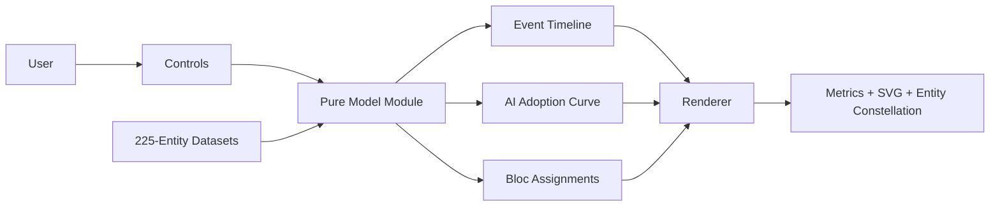

# Architecture: Institutional Agent Consolidation Visualizer

## System context

The visualizer is a local presentation layer over the mathematical model in `math-model.md` and `global-ai-consolidation.md`. It is intentionally independent of AWS, CTDI production systems, and external data APIs.



## Components

### `web/countries.mjs`

Exports an immutable ordered array of 195 names: 193 UN Member States and two UN Observer States. Ordering is alphabetical for stable rendering and deterministic assignments.

### `web/tech-companies.mjs`

Exports 30 revenue-driven technology institution records with approximate revenue rank, annual revenue, origin, and sector. Selection methodology is documented in `ENTITY_BASELINE.md`.

### `web/references.mjs`

Exports the citation registry and display order. Every record declares an epistemic kind, explanation, and one or more HTTPS sources. Source pages are not requested until a user selects a link.

### `web/model.mjs`

Pure functions with no DOM access:

- validate and clamp parameters;
- compute qualifying-event intervals;
- derive effective consolidation, qualifying-conflict share, and internal-fracture pressure from the optional Big Cycle economics layer;
- execute event-based consolidation;
- calculate structural Apex Institution influence, cohort implementation depth, effective Apex Institution influence, and first threshold crossing;
- construct approximately equal Institutions while preserving every named constituent institution;
- locate the independent-center count at an elapsed year;
- compute logistic AI architecture adoption;
- estimate adoption threshold times;
- assign countries deterministically to blocs;
- format finite and non-converging outcomes.

### `web/app.mjs`

Browser orchestration:

- reads controls and URL hash;
- calls model functions;
- renders cards, chart, country/corporate nodes, and bloc summaries;
- manages timeline animation;
- preserves scenario settings in the hash;
- hydrates accessible hover/focus citations;
- renders the persistent reference ledger; and
- exposes textual interpretation.

### `web/index.html`

Semantic HTML shell containing all labels, controls, landmarks, fallback messaging, and visualization containers.

### `web/styles.css`

Responsive layout, palette, animation, focus states, chart presentation, and reduced-motion behavior.

## Empirical validation control plane

```text
versioned JSON contracts
  → referential and gate validation
  → deterministic Markdown documentation
  → SHA-256 manifest
  → Gate A decision
  → state-only data scaffold
  → unresolved identifier crosswalk
  → licensed source ingestion [next]
```

`research/` is the machine-readable source of truth. Generated Phase 0 documents must not be edited manually. Default values are separately governed by `defaults-rationale.v1.json`; generated hover evidence and `DEFAULT_VALUES.md` must exactly match the production model. `data/catalog.yml` controls source promotion, and external identifiers remain unresolved until reviewed against frozen source versions.

The first empirical path is checksum-locked: COW ZIP → native membership spells → state-year exposure → entry/exit events → annual counts → Kaplan–Meier survival → bootstrap hazard → rolling-origin constant-hazard backtest. COW exits remain semantically unclassified until cause coding is independently reviewed.

## Analysis pipeline

```text
12 scenario archetypes
  → 64 seeded variants each
  → production JavaScript model
  → 768-row CSV
  → standardized NumPy PCA
  → component/outcome correlations and archetype summaries
  → JSON + Markdown + static browser module
```

PCA is applied only to assumption variables. Output correlations are descriptive, and non-reaching scenarios remain explicitly right-censored.

## Simulation sequence

1. Initialize defaults with `S_0 = 225` and internal conflict `i = 5%`.
2. Center the economic strength and systemic-stress controls and apply the selected coupling.
3. Derive effective consolidation, qualifying-event share, and internal conflict.
4. Derive the mean qualifying-event interval from conflict interval and effective qualifying share. If a current wave is enabled, resolve it exactly at elapsed year 3; sample every later interarrival from normalized 6/36/124-year clustered gaps around the acceleration-adjusted mean.
5. Draw one latent beta severity per wave, then binomial institution losses and internal fragments. Continue until one agent remains, the horizon is exceeded, or the 10,000-event computational guard is reached. Event-limit runs retain only states actually simulated.
6. Sample timeline points for chart rendering.
7. At the selected elapsed year, assign one synthetic, hash-balanced set to the growing Apex Institution network and preserve remaining institutions as independent centers.
8. Evaluate every Apex Institution entry cohort using the adjustable institutional-standard adoption rate and aggregate effective coverage.
9. Independently evaluate logistic AI architecture adoption.
10. Render the effective economics panel, conditional outcome, and assumptions.
11. Hydrate inline reference markers and render the evidence ledger from one registry.

## Important semantics

- The Apex Institution network is a visualization of coordination coverage, not a forecasted alliance or ruler.
- Country ordering does not imply rank; corporate rank records approximate revenue order only.
- “Agent” means the top-level institution in this thought experiment.
- A common AI architecture does not imply common governance.
- Structural hierarchy membership does not imply internally implemented or enforceable Apex Institution standards.
- Dalio-inspired economic scores are manual scenario inputs, not measurements of current institutions.
- Neutral 50% strength and stress preserve the pre-economics baseline exactly.
- A move beyond roughly 50% is terminal: two approximately equal Institutions transition directly to one top-level Apex Institution. Effective dominance follows when internal adoption exceeds 50%.
- Every named country and corporation persists as an institutional node throughout the visualization.
- Fragmentation parameters create independent centers only before Apex consolidation.
- One operational Apex center is an absorbing state: constituent organizations may churn, but independent top-level power cannot re-emerge in the current model.
- LLM-scale analysis, durable memory, infrastructure control, and observability are the proposed lock-in mechanism; their sufficiency is an assumption, not a validated result.

## Power-calcification state contract

```text
pre-Apex transitions: S′ = S − losses + external fragments + internal fragments
post-Apex while operational: S = 1 => S′ = 1
post-Apex organizational births: curated constituents, not independent centers
```

`web/model.mjs` exports `POWER_CALCIFICATION_ASSUMPTIONS`, and `nextAgentCount` enforces the absorbing state independently of the simulation loop. System collapse, observability failure, successful escape, and objective-system replacement are outside the current transition graph; see `POWER_CALCIFICATION.md`.

## Failure behavior

- Zero qualifying share: no consolidation events.
- External or internal fragmentation offsets consolidation: mark convergence as absent.
- Invalid URL values: clamp to documented ranges.
- Unsupported JavaScript: retain explanatory static HTML and `<noscript>` notice.
- Dataset mismatch: automated tests fail before use.
- Unknown or incomplete reference key: unit tests fail and browser hydration reports an error.
- External source unavailable: the local model remains functional because citations are links rather than runtime inputs.
- Missing or stale research docs or checksums: `tests/test_research_contract.py` fails Gate A.
- False external identifier claims: `tests/test_data_scaffold.py` requires every seed mapping to remain unresolved.
- Missing or stale analysis artifacts: `tests/test_analysis.py` fails before the browser summary is accepted.
- PCA dependency unavailable: install the exact version in `analysis/requirements.txt`; no browser functionality depends on NumPy at runtime.

## Data classification

Public country and corporation names, approximate corporate revenues, and user-entered numeric assumptions only. No personal, confidential, restricted, or CTDI operational data.

## Scenario and model-challenge pipeline

```text
fixed scenario registry → production model → scenario matrix CSV/JSON/Markdown/web module
COW exit spells → 40 clustering specifications → leave-one-wave-out + robustness web module
COW Institution-years → six rolling 25-year blocks → seven model scores + comparison web module
```

`analysis/generate_scenario_matrix.mjs` owns the declared scenarios. `analysis/cow_wave_robustness.py` owns gross/durable clustering sensitivity and leave-one-out estimates. `analysis/cow_model_comparison.py` owns leakage-controlled one-year-ahead exit prediction and proper scores. Generated modules are imported by `web/app.mjs`; the browser performs no external data access.

The model comparison is deliberately narrower than the Apex Institution model: it predicts COW membership exits. The production prior is mapped to annual risk as `qualifyingShare × institutionEventProbability / conflictInterval`. This reduced-form bridge is diagnostic and does not validate permanent subjugation, future wave timing, or causal mechanisms.

## Target-five exploration pipeline

`institutionCountThresholdYear(simulation, 5)` returns the first timeline point at or below five independent top-level Institutions. `analysis/target_five_analysis.mjs` locks boundary comparisons to 225 starting Institutions and generates boundary proofs, seven anchor cases, eight one-at-a-time parameter groups, a 25-cell frequency grid, and a 48-cell severity/internal-conflict grid. Outputs are JSON, CSV, Markdown, and `web/target-five-analysis.mjs`.

The browser imports the generated presets and exposes `Fastest to 5` and `5 in 7026` buttons plus a live target-year metric. Institutional-standard adoption remains excluded from the structural objective. Architecture diffusion enters only through the explicit acceleration feedback when the control is above zero.

## Monte Carlo uncertainty pipeline

```text
research/monte-carlo-assumptions.v1.json
  + COW definition-robustness means
  → seeded independent Latin-hypercube sampling
  → 4 profiles × 10,000 seeded stochastic simulations
  → run-level CSV + summary JSON/CSV + Markdown + checksum manifest
  → web/monte-carlo-results.mjs + downloadable summary
```

`analysis/monte_carlo_sampling.mjs` owns PRNG, inverse-normal, profile inheritance, Latin-hypercube columns, and distribution transforms. `analysis/monte_carlo_statistics.mjs` owns quantiles, censored-time summaries, survival points, terminal bands, convergence checkpoints, and Spearman sensitivity. `analysis/monte_carlo_simulation.mjs` runs the production model and generates artifacts.

The browser is a static profile explorer; it does not rerun 10,000 simulations in the UI or request external services. Run-level samples remain in `analysis/output/monte-carlo-runs.csv`; browser delivery exposes summarized distributions only.

## Economic-power ranking pipeline

```text
checksum-locked WDI GDP panel + company revenue baseline
  → alias-controlled 195-country match
  → latest positive GDP and approximately 10-year nominal CAGR
  → company origin-GDP growth proxy
  → generated 225-record browser module + CSV + checksum manifest
  → log-space growth and conflict shock/recovery projection
  → descending rank, normalized shares, and economic Independent 1 influence
```

`analysis/generate_economic_power.mjs` owns data generation. `web/economic-power-data.mjs` is generated and must not be hand-edited. `web/economic-power.mjs` owns growth clipping, conflict multipliers, log-space projection, ranking, and normalized shares.

The runtime uses the selected year and baseline conflict interval. Every conflict begins at a `0.90×` level multiplier, recovers linearly over ten years, and becomes a `1.03×` permanent level multiplier. Country annual growth is clipped to `[-5%, +15%]`. Company growth is an origin-country GDP proxy, not observed corporate revenue growth.

The constellation receives institutions in descending economic order and preserves that order when building displayed hierarchy assignments. Independent 1 is therefore the strongest measured entity when all 225 centers are independent. Its interface influence equals its bloc's economic-power share multiplied by existing internal implementation depth. Core event timing, Monte Carlo outputs, and Apex threshold calculations remain count-based in this revision.

Three country records—Holy See, Nauru, and North Korea—lack measured GDP in the cached panel. They remain null, receive zero normalized economic share, and sort after measured entities. This is preferable to fabricated values.

The joint GDP/revenue order is not an accounting total: corporate gross revenue overlaps national value-added GDP. It is a user-requested influence heuristic with an explicit double-counting warning.

## Article presentation architecture

`web/index.html` now contains exactly five numbered `article-part` sections with stable IDs:

```text
#casual-review
  → headline thesis + curated variable findings
  → generated target-five timeline cards
  → generated COW-centered uncertainty cards
#deeper-analysis
  → power-calcification mechanism + interpretive boundaries
#model-interface
  → controls + complete interactive visualization workspace
#simulation-analysis
  → sensitivity + scenarios + Monte Carlo + empirical + PCA
#references-assumptions
  → conceptual map + robustness + evidence ledger + boundary
```

The sticky `article-nav` links to every section and degrades to a wrapping/scrollable layout on smaller screens. Each section has a visible number and an accessible heading relationship.

`renderArticleSummary()` in `web/app.mjs` reads representative `T₅` values directly from `TARGET_FIVE_ANALYSIS.boundaries` and named anchors. It reads reach, conditional median, censoring, and terminal-count values from the `cow_centered` profile in `MONTE_CARLO_RESULTS`. The article lead therefore changes when generated analysis artifacts change, subject to regression tests for required bindings.

The editorial layer does not create a new analytical pipeline or alter equations. It reorganizes existing tested material into conclusions-first reading order while preserving every prior control, diagnostic container, empirical caveat, and reference.

## Calendar-year presentation contract

The pure model advances in elapsed time from `BASE_YEAR = 2026`. `calendarYear(t)` maps outcome time to `2026 + round(t)`, while `calendarYearOrNull` preserves censored/null events. Browser metrics, chart axes, article cards, scenario tables, Monte Carlo plots, and PCA summaries display calendar years.

Generated artifacts retain elapsed fields for calculations and compatibility and add calendar companions. The target-five, scenario-matrix, model-insight, Monte Carlo, and synthetic-scenario/PCA pipelines all publish a base year and censoring calendar year. Reports use dates for event outcomes and durations only for intervals, recovery windows, finite spreads, and rates.

## Acceleration feedback architecture

Before every transition, `simulateConsolidation` calls `consolidationAccelerationState` with current elapsed time, active centers, AI diffusion, and the Big-Cycle-adjusted base loss probability. The returned bounded multiplier controls the next event interval only; it does not alter loss probability. Event points record the multiplier and accelerated probability; simulations expose the maximum reached multiplier.

The control is included in URL state, defaults rationale, target-five sweeps, scenario/PCA inputs, global screening, and all Monte Carlo profiles. The zero setting is an exact ablation. The fixed `5×` ceiling is a disclosed hidden constant.

Only one feedback parameter is implemented. Hawkes, coagulation, preferential-attachment, and separate tempo/severity/suppression architectures remain alternatives because adding all of them would create overlapping, weakly identifiable effects.

## Tolerance-gap presentation

Section 2 contains a non-interactive model-gap callout for pluralism tolerance. It intentionally has no slider, entity data, or transition equation. The evidence ledger defines the proposed construct and review boundary. Future implementation requires a versioned codebook and Institution-level evidence dataset before adding `τ_i` to the model or analysis contracts.

## Annotated bibliography pipeline

`analysis/generate_annotated_bibliography.mjs` merges `source-catalog.v1.json`, `bibliography-supplement.v1.json`, and every source in `references.mjs`. URLs are normalized to HTTPS and deduplicated. Catalog metadata takes precedence; assumption usage is merged from the reference registry.

The generated browser module contains grouped empirical, theory/method, and governance/context entries. `renderAnnotatedBibliography()` creates safe text nodes and external links with `noopener noreferrer`. The bibliography follows the model-boundary block and is the article's final substantive content.

A curated supplement captures external research links discovered in proxy and license files that are not formal source-catalog records. An automated audit verifies all authored non-local external URLs are represented.

The bibliography UI has two navigation levels. `REFERENCE_TO_DEFAULT` generates always-visible `#bib-topic-{referenceKey}` cards containing the selected default, evidence tier, rationale, derivation, and links to full source cards. Each control popover links to its topic card. Full entries are grouped in native `<details>` elements; selecting a source from a topic automatically opens its category and targets `#bib-{sourceId}`.

The bibliography generator also pre-renders all topic cards, expandable groups, annotations, and external links between deterministic markers in `index.html`. JavaScript enhances and refreshes that content but is no longer required for links to exist in page source.

## Existential outcome semantics

`CIVILIZATIONAL_OUTCOME_ASSUMPTIONS` freezes separate Apex, disempowerment, and extinction semantics. `civilizationalOutcome()` reports the effective Apex year and leaves human-disempowerment and biological-extinction years unknown. Section 5 labels fixed-scenario and Monte Carlo values as Apex coordination results and presents six unclassified post-Apex governance outcomes.

## Historical reset comparison

The Casual Review contains a static, semantic `#historical-reset` comparison before quantitative results. It contrasts succession, generational reinterpretation, economic crisis/reform, administrative forgetting, and visibility gaps with the authored AI-persistence premise. The title links to the existing `powerCalcification` reference topic. No new model variable is implied: zero post-Apex authority decay and the absorbing Apex state remain the production proxies for removal of generational forgetting. The Deeper Analysis `memory-decay-note` states that deliberate unlearning and de-calcification are not parameterized.
