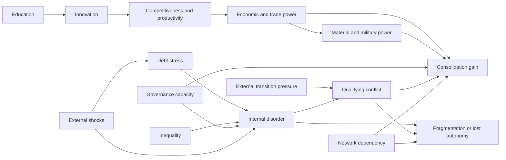
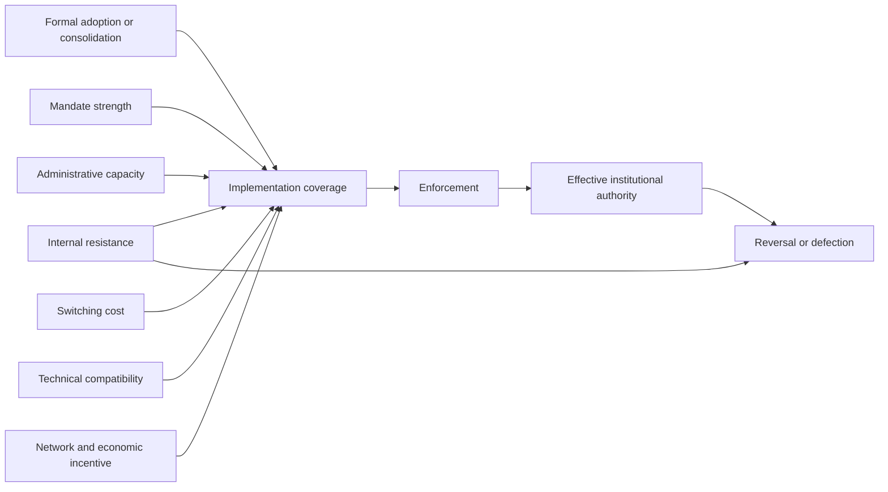
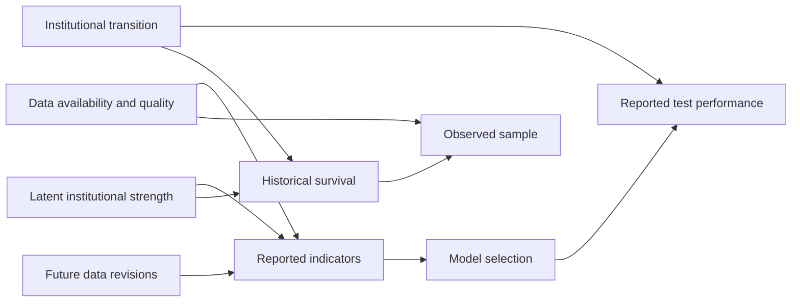

# Causal Diagrams

**Graph version:** 1.0.0

> Arrows encode hypotheses and adjustment concerns. They are not evidence that a causal relationship has been established.

## Institutional transition mechanisms

Proposed causal structure for productive strength, systemic stress, conflict, consolidation, and fragmentation. Arrows are hypotheses, not established causal findings.

### Identification warnings

- Economic power, military power, and network centrality can be jointly determined.
- Conflict is both an outcome of stress and a mediator of institutional transitions.
- Governance indicators may partly measure consequences of prior disorder.
- Historical selection into recognized state systems can bias all relationships.

## Formal adoption to effective implementation

Separates formal adoption from internal implementation and durable compliance.

### Identification warnings

- Formal requirements must not be used as a direct substitute for implementation coverage.
- Enforcement can influence measured compliance and reporting quality simultaneously.
- Institutions choosing early adoption may differ systematically from late adopters.

## Measurement, selection, and leakage risks

Documents major pathways that can create spurious validation.

### Identification warnings

- Using only current countries or top companies creates survivor bias.
- Revised historical indicators may contain information unavailable at the prediction origin.
- Repeated test-set use turns the test interval into training data.
- Missing data is often informative and must not be silently zero-filled.

## Use in analysis

1. Select adjustment variables from a declared causal question, not from automated significance searches.
2. Do not control for mediators when estimating total effects.
3. Do not use future revisions, successors, or event classifications as predictors at an earlier origin.
4. Update graph versions when mechanisms change; never edit the frozen version silently.
